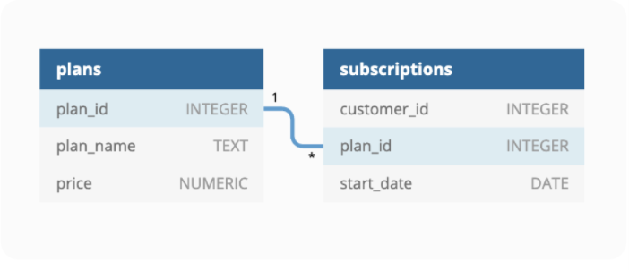
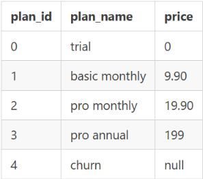
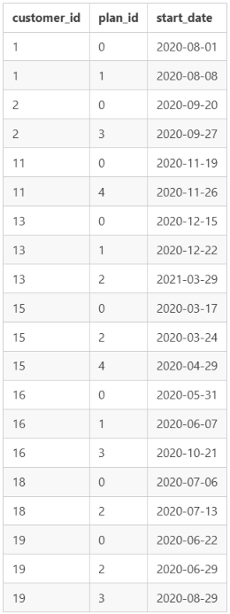

# Case Study #3 - Foodie-Fi


## Table of Contents

- [Business Task](#business-task)
- [Entity Relationship Diagram](#entity-relationship-diagram)
- [Questions and Solutions](#questions-and-solutions)

  Please note that all the information regarding this case study has been sourced from the following link: [here](https://8weeksqlchallenge.com/case-study-3/).

## Business Task

Danny and his friends launched a new startup Foodie-Fi and started selling monthly and annual subscriptions, giving their customers unlimited on-demand access to exclusive food videos from around the world.

This case study focuses on using subscription-style digital data to answer important business questions on customer journey, payments, and business performance.

## Entity Relationship Diagram



### Table 1: `plans`



There are 5 customer plans.

- **Trial:** Customers sign up for an initial 7-day free trial and automatically continue with the Pro Monthly subscription unless they cancel, downgrade to Basic, or upgrade to an Annual Pro plan during the trial.
- **Basic plan:** Customers have limited access and can only stream videos. It is available monthly at $9.90.
- **Pro plan:** Customers have no watch-time limits and can download videos for offline viewing. Pro plans cost $19.90 per month or $199 for an annual subscription.

When customers cancel their Foodie-Fi service, they receive a Churn plan record with a NULL price. However, their subscription continues until the end of the billing period.

### Table 2: `subscriptions`



Customer subscriptions show the exact date when their specific `plan_id` starts.

- If customers downgrade from a Pro plan or cancel their subscription, the higher plan remains active until the current billing period ends. The `start_date` in the subscriptions table reflects the date when the actual plan changes.
- When customers upgrade from a Basic plan to a Pro or Annual Pro plan, the higher plan takes effect immediately.
- When customers churn, they retain access until the end of their current billing period. However, the `start_date` records the date they decided to cancel.

## Questions and Solutions

### A. Customer Journey

**Question:** Based on the 8 sample customers provided in the `subscriptions` table, write a brief description about each customer's onboarding journey.

```sql
SELECT
    subscriptions.customer_id,
    plans.plan_id,
    plans.plan_name,
    subscriptions.start_date
FROM foodie_fi.subscriptions
JOIN foodie_fi.plans
    ON subscriptions.plan_id = plans.plan_id
WHERE subscriptions.customer_id IN (1, 2, 11, 13, 15, 16, 18, 19)
ORDER BY subscriptions.customer_id, subscriptions.start_date;
```

**Output:**

| customer_id | plan_id | plan_name | start_date |
|---:|---:|---|---|
| 1 | 0 | trial | 2020-08-01 |
| 1 | 1 | basic monthly | 2020-08-08 |
| 2 | 0 | trial | 2020-09-20 |
| 2 | 3 | pro annual | 2020-09-27 |
| 11 | 0 | trial | 2020-11-19 |
| 11 | 4 | churn | 2020-11-26 |
| 13 | 0 | trial | 2020-12-15 |
| 13 | 1 | basic monthly | 2020-12-22 |
| 13 | 2 | pro monthly | 2021-03-29 |
| 15 | 0 | trial | 2020-03-17 |
| 15 | 2 | pro monthly | 2020-03-24 |
| 15 | 4 | churn | 2020-04-29 |
| 16 | 0 | trial | 2020-05-31 |
| 16 | 1 | basic monthly | 2020-06-07 |
| 16 | 3 | pro annual | 2020-10-21 |
| 18 | 0 | trial | 2020-07-06 |
| 18 | 2 | pro monthly | 2020-07-13 |
| 19 | 0 | trial | 2020-06-22 |
| 19 | 2 | pro monthly | 2020-06-29 |
| 19 | 3 | pro annual | 2020-08-29 |

**Customer Journey:**

- **Customer 1:** Started with a free trial on 1 August 2020 and subscribed to the Basic monthly plan on 8 August 2020.
- **Customer 13:** Started with a free trial on 15 December 2020, subscribed to the Basic monthly plan on 22 December 2020, and upgraded to the Pro monthly plan on 29 March 2021.
- **Customer 15:** Started with a free trial on 17 March 2020, upgraded to the Pro monthly plan on 24 March 2020, and decided to cancel on 29 April 2020.
