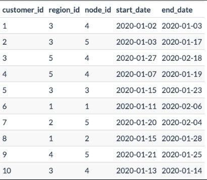

# Case Study #4 - Data Bank


## Table of Contents

- [Business Task](#business-task)
- [Entity Relationship Diagram](#entity-relationship-diagram)
- [Questions and Solutions](#questions-and-solutions)

## Business Task

Data Bank is a digital bank that also provides a distributed data storage platform. Customers' cloud storage limits are linked to the amount of money they hold in their accounts, and their funds and data are stored across a network of nodes.

The management team wants to grow its customer base and understand how much data storage customers will require in the future.

This case study focuses on analysing customer transactions and node allocations to calculate key business metrics, identify growth trends and help Data Bank forecast its future storage requirements.

Please note that all the information regarding this case study has been sourced from the following link: [8 Week SQL Challenge – Case Study 4](https://8weeksqlchallenge.com/case-study-4/).

## Entity Relationship Diagram


### Table 1: `regions`


Just like popular cryptocurrency platforms, Data Bank operates through a network of nodes where both money and data are stored across the globe. In traditional banking terms, these nodes can be considered similar to bank branches or stores located around the world.

### Table 2: `customer_nodes`



Customers are randomly distributed across nodes according to their region. This also specifies exactly which node contains their cash and data.

This random distribution changes frequently to reduce the risk of hackers accessing Data Bank's system and stealing customers' money and data.

### Table 3: `customer_transactions`


This table stores all customer deposits, withdrawals and purchases made using their Data Bank debit card.

## Questions and Solutions

# A. Customer Nodes Exploration

### Question 1: How many unique nodes are there on the Data Bank system?

**SQL Query**

```sql
SELECT
    COUNT(DISTINCT node_id) AS unique_nodes
FROM data_bank.customer_nodes;
```

**Output**

| unique_nodes |
|---:|
| To be populated |

**Interpretation:** This identifies the total number of distinct nodes in the Data Bank system.

---

### Question 2: What is the number of nodes per region?

**SQL Query**

```sql
SELECT
    regions.region_name,
    COUNT(DISTINCT customer_nodes.node_id) AS total_nodes
FROM data_bank.customer_nodes
JOIN data_bank.regions
    ON customer_nodes.region_id = regions.region_id
GROUP BY regions.region_name
ORDER BY regions.region_name;
```

**Output**

| region_name | total_nodes |
|---|---:|
| To be populated | — |

**Interpretation:** This compares the number of distinct nodes across different regions.

---

### Question 3: How many customers are allocated to each region?

**SQL Query**

```sql
SELECT
    regions.region_name,
    COUNT(DISTINCT customer_nodes.customer_id) AS total_customers
FROM data_bank.customer_nodes
JOIN data_bank.regions
    ON customer_nodes.region_id = regions.region_id
GROUP BY regions.region_name
ORDER BY regions.region_name;
```

**Output**

| region_name | total_customers |
|---|---:|
| To be populated | — |

**Interpretation:** This shows how customers are distributed across different regions.

---

### Question 4: How many days on average are customers reallocated to a different node?

**SQL Query**

```sql
SELECT
    ROUND(
        AVG(end_date - start_date),
        2
    ) AS average_reallocation_days
FROM data_bank.customer_nodes
WHERE end_date != '9999-12-31';
```

**Output**

| average_reallocation_days |
|---:|
| To be populated |

**Interpretation:** This calculates the average number of days customers remain allocated to a node before being reallocated.

---

### Question 5: What is the median, 80th and 95th percentile for this same reallocation days metric for each region?

**SQL Query**

```sql
SELECT
    regions.region_name,
    PERCENTILE_CONT(0.50) WITHIN GROUP (
        ORDER BY customer_nodes.end_date - customer_nodes.start_date
    ) AS median_days,
    PERCENTILE_CONT(0.80) WITHIN GROUP (
        ORDER BY customer_nodes.end_date - customer_nodes.start_date
    ) AS percentile_80_days,
    PERCENTILE_CONT(0.95) WITHIN GROUP (
        ORDER BY customer_nodes.end_date - customer_nodes.start_date
    ) AS percentile_95_days
FROM data_bank.customer_nodes
JOIN data_bank.regions
    ON customer_nodes.region_id = regions.region_id
WHERE customer_nodes.end_date != '9999-12-31'
GROUP BY regions.region_name
ORDER BY regions.region_name;
```

**Output**

| region_name | median_days | percentile_80_days | percentile_95_days |
|---|---:|---:|---:|
| To be populated | — | — | — |

**Interpretation:** This measures typical and longer customer allocation periods across regions.

---

# B. Customer Transactions

### Question 1: What is the unique count and total amount for each transaction type?

**SQL Query**

```sql
SELECT
    txn_type,
    COUNT(*) AS transaction_count,
    SUM(txn_amount) AS total_amount
FROM data_bank.customer_transactions
GROUP BY txn_type
ORDER BY txn_type;
```

**Output**

| txn_type | transaction_count | total_amount |
|---|---:|---:|
| To be populated | — | — |

**Interpretation:** This compares the number and total value of deposits, purchases and withdrawals.

---

### Question 2: What is the average total historical deposit counts and amounts for all customers?

**SQL Query**

```sql
WITH customer_deposits AS (
    SELECT
        customer_id,
        COUNT(*) AS deposit_count,
        SUM(txn_amount) AS total_deposit_amount
    FROM data_bank.customer_transactions
    WHERE txn_type = 'deposit'
    GROUP BY customer_id
)

SELECT
    ROUND(AVG(deposit_count), 2) AS average_deposit_count,
    ROUND(AVG(total_deposit_amount), 2) AS average_deposit_amount
FROM customer_deposits;
```

**Output**

| average_deposit_count | average_deposit_amount |
|---:|---:|
| To be populated | — |

**Interpretation:** This calculates the average number of deposits and average total deposit amount per customer.

---

### Question 3: For each month - how many Data Bank customers make more than 1 deposit and either 1 purchase or 1 withdrawal in a single month?

**SQL Query**

```sql
SELECT
    DATE_TRUNC('month', txn_date)::DATE AS transaction_month,
    COUNT(DISTINCT customer_id) AS total_customers
FROM data_bank.customer_transactions
GROUP BY
    DATE_TRUNC('month', txn_date),
    customer_id
HAVING
    COUNT(*) FILTER (WHERE txn_type = 'deposit') > 1
    AND (
        COUNT(*) FILTER (WHERE txn_type = 'purchase') >= 1
        OR
        COUNT(*) FILTER (WHERE txn_type = 'withdrawal') >= 1
    )
ORDER BY transaction_month;
```

**Output**

| transaction_month | total_customers |
|---|---:|
| To be populated | — |

**Interpretation:** This identifies customers who made more than one deposit and at least one purchase or withdrawal in each month.

---

### Question 4: What is the closing balance for each customer at the end of the month?

**SQL Query**

```sql
WITH monthly_transactions AS (
    SELECT
        customer_id,
        DATE_TRUNC('month', txn_date)::DATE AS transaction_month,
        SUM(
            CASE
                WHEN txn_type = 'deposit' THEN txn_amount
                ELSE -txn_amount
            END
        ) AS monthly_net_transaction
    FROM data_bank.customer_transactions
    GROUP BY
        customer_id,
        DATE_TRUNC('month', txn_date)
)

SELECT
    customer_id,
    transaction_month,
    SUM(monthly_net_transaction) OVER (
        PARTITION BY customer_id
        ORDER BY transaction_month
    ) AS closing_balance
FROM monthly_transactions
ORDER BY customer_id, transaction_month;
```

**Output**

| customer_id | transaction_month | closing_balance |
|---:|---|---:|
| To be populated | — | — |

**Interpretation:** This calculates each customer's cumulative balance at the end of each month.

---

### Question 5: What is the percentage of customers who increase their closing balance by more than 5%?

**SQL Query**

```sql
WITH monthly_transactions AS (
    SELECT
        customer_id,
        DATE_TRUNC('month', txn_date)::DATE AS transaction_month,
        SUM(
            CASE
                WHEN txn_type = 'deposit' THEN txn_amount
                ELSE -txn_amount
            END
        ) AS monthly_net_transaction
    FROM data_bank.customer_transactions
    GROUP BY
        customer_id,
        DATE_TRUNC('month', txn_date)
),

monthly_balances AS (
    SELECT
        customer_id,
        transaction_month,
        SUM(monthly_net_transaction) OVER (
            PARTITION BY customer_id
            ORDER BY transaction_month
        ) AS closing_balance
    FROM monthly_transactions
),

balance_changes AS (
    SELECT
        customer_id,
        transaction_month,
        closing_balance,
        LAG(closing_balance) OVER (
            PARTITION BY customer_id
            ORDER BY transaction_month
        ) AS previous_closing_balance
    FROM monthly_balances
)

SELECT
    ROUND(
        100.0 * COUNT(DISTINCT customer_id) FILTER (
            WHERE closing_balance > previous_closing_balance * 1.05
        )
        / COUNT(DISTINCT customer_id),
        2
    ) AS percentage_customers
FROM balance_changes
WHERE previous_closing_balance > 0;
```

**Output**

| percentage_customers |
|---:|
| To be populated |

**Interpretation:** This calculates the percentage of customers whose closing balance increased by more than 5% compared with their previous month's closing balance.

---

# C. Data Allocation Challenge

### Question 1: Generate a running customer balance column that includes the impact of each transaction.

**SQL Query**

```sql
SELECT
    customer_id,
    txn_date,
    txn_type,
    txn_amount,
    SUM(
        CASE
            WHEN txn_type = 'deposit' THEN txn_amount
            ELSE -txn_amount
        END
    ) OVER (
        PARTITION BY customer_id
        ORDER BY txn_date, txn_type, txn_amount
        ROWS BETWEEN UNBOUNDED PRECEDING AND CURRENT ROW
    ) AS running_balance
FROM data_bank.customer_transactions
ORDER BY customer_id, txn_date, txn_type, txn_amount;
```

**Output**

| customer_id | txn_date | txn_type | txn_amount | running_balance |
|---:|---|---|---:|---:|
| To be populated | — | — | — | — |

**Interpretation:** This tracks how each customer's balance changes after every transaction.

---

### Question 2: Calculate the customer balance at the end of each month.

**SQL Query**

```sql
WITH monthly_transactions AS (
    SELECT
        customer_id,
        DATE_TRUNC('month', txn_date)::DATE AS transaction_month,
        SUM(
            CASE
                WHEN txn_type = 'deposit' THEN txn_amount
                ELSE -txn_amount
            END
        ) AS monthly_net_transaction
    FROM data_bank.customer_transactions
    GROUP BY
        customer_id,
        DATE_TRUNC('month', txn_date)
)

SELECT
    customer_id,
    transaction_month,
    SUM(monthly_net_transaction) OVER (
        PARTITION BY customer_id
        ORDER BY transaction_month
    ) AS month_end_balance
FROM monthly_transactions
ORDER BY customer_id, transaction_month;
```

**Output**

| customer_id | transaction_month | month_end_balance |
|---:|---|---:|
| To be populated | — | — |

**Interpretation:** This provides a monthly snapshot of each customer's cumulative account balance.

---

### Question 3: Calculate the minimum, average and maximum values of the running balance for each customer.

**SQL Query**

```sql
WITH running_balances AS (
    SELECT
        customer_id,
        txn_date,
        txn_type,
        txn_amount,
        SUM(
            CASE
                WHEN txn_type = 'deposit' THEN txn_amount
                ELSE -txn_amount
            END
        ) OVER (
            PARTITION BY customer_id
            ORDER BY txn_date, txn_type, txn_amount
            ROWS BETWEEN UNBOUNDED PRECEDING AND CURRENT ROW
        ) AS running_balance
    FROM data_bank.customer_transactions
)

SELECT
    customer_id,
    MIN(running_balance) AS minimum_balance,
    ROUND(AVG(running_balance), 2) AS average_balance,
    MAX(running_balance) AS maximum_balance
FROM running_balances
GROUP BY customer_id
ORDER BY customer_id;
```

**Output**

| customer_id | minimum_balance | average_balance | maximum_balance |
|---:|---:|---:|---:|
| To be populated | — | — | — |

**Interpretation:** This summarizes each customer's minimum, average and maximum running balance throughout the transaction history.
