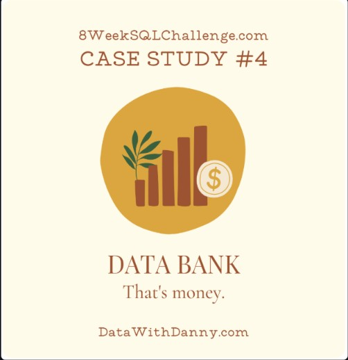
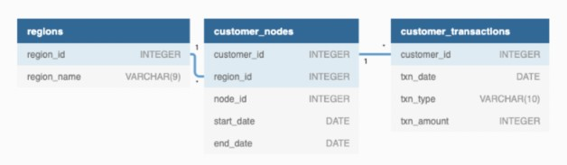
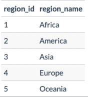
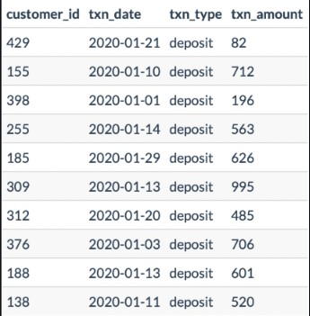

# Case Study #4 - Data Bank

## Table of Contents

- [Business Task](#business-task)
- [Entity Relationship Diagram](#entity-relationship-diagram)
- [Questions and Solutions](#questions-and-solutions)

## Business Task

Data Bank is a digital bank that also provides a distributed data storage platform. Customers' cloud storage limits are linked to the amount of money they hold in their accounts, and their funds and data are stored across a network of nodes.

The management team wants to grow its customer base and understand how much data storage customers will require in the future.

This case study focuses on analysing customer transactions and node allocations to calculate key business metrics, identify growth trends and help Data Bank forecast its future storage requirements.

Please note that all the information regarding this case study has been sourced from the following link: [8 Week SQL Challenge – Case Study 4](https://8weeksqlchallenge.com/case-study-4/).

## Entity Relationship Diagram

### Table 1: `regions`

Just like popular cryptocurrency platforms, Data Bank operates through a network of nodes where both money and data are stored across the globe. In traditional banking terms, these nodes can be considered similar to bank branches or stores located around the world.

### Table 2: `customer_nodes`

Customers are randomly distributed across nodes according to their region. This also specifies exactly which node contains their cash and data.

This random distribution changes frequently to reduce the risk of hackers accessing Data Bank's system and stealing customers' money and data.

### Table 3: `customer_transactions`

This table stores all customer deposits, withdrawals and purchases made using their Data Bank debit card.

## Questions and Solutions
